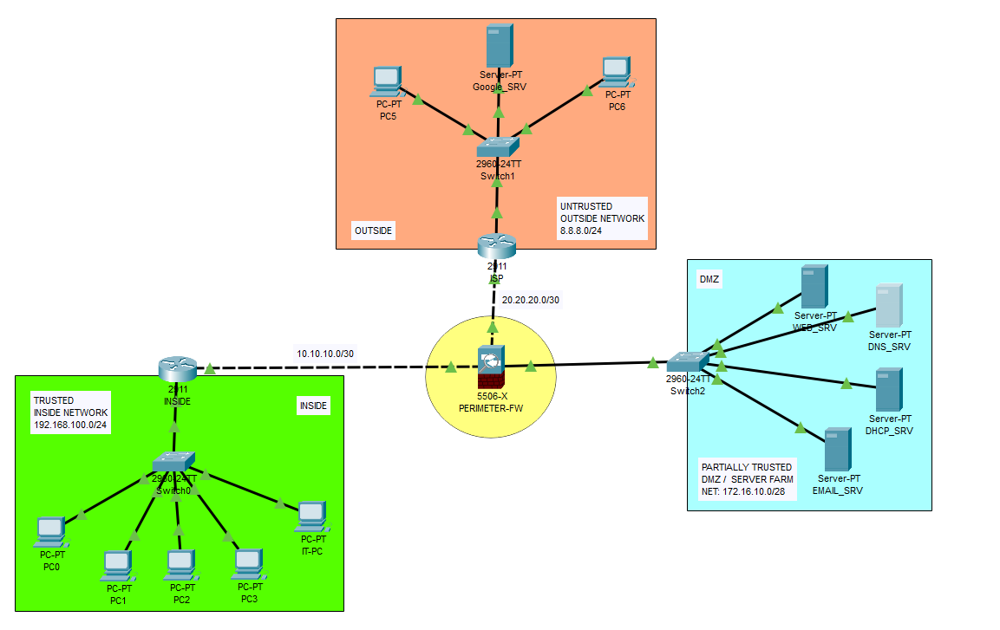
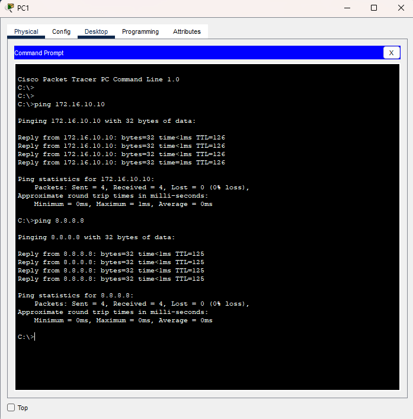
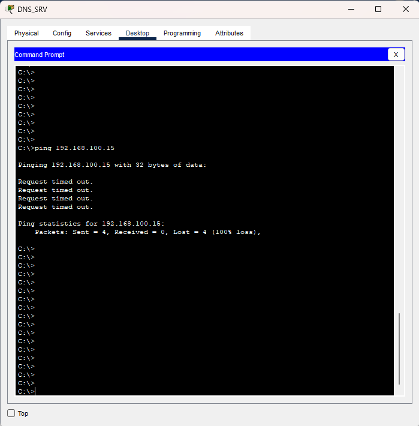
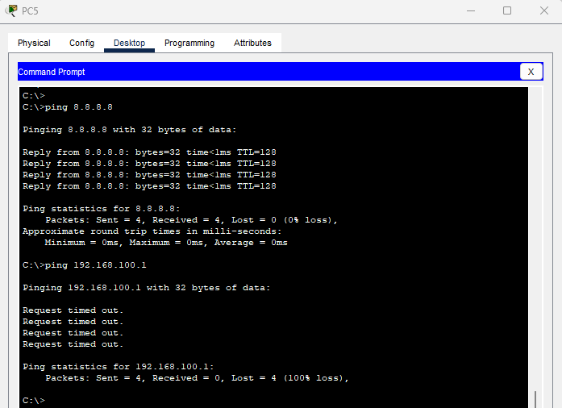

# Cisco ASA 5506-X Firewall, OSPF, DHCP Relay, PAT and DMZ Security Lab



## Overview

This Cisco Packet Tracer lab demonstrates a three-zone perimeter built around a Cisco ASA 5506-X. The design separates a trusted inside LAN, a partially trusted DMZ server farm, and an untrusted outside network. It combines ASA security levels, OSPF, static default routing, dynamic PAT configuration, centralized DHCP relay, SSH administration, stateful ICMP inspection, and a least-privilege DMZ ACL.

The project intentionally includes both positive and negative tests: approved inside traffic succeeds, while unsolicited DMZ-to-inside and outside-to-inside traffic is denied.

> **Simulator note:** Packet Tracer implements only part of the ASA CLI. Unsupported commands and validation limits are documented in [`limitations/packet-tracer-asa-limitations.md`](limitations/packet-tracer-asa-limitations.md).

## Skills demonstrated

- ASA interface naming and security levels
- INSIDE, DMZ, and OUTSIDE zone design
- OSPF adjacency and route exchange through the ASA
- Static default route toward an ISP
- Dynamic object PAT configuration
- Centralized DHCP in the DMZ
- DHCP relay from a routed inside LAN
- Local AAA and SSH restricted to the inside network
- Global ICMP inspection
- Inbound interface ACL direction and rule ordering
- Least-privilege exception for DHCP relay responses
- Positive and negative firewall testing

## Addressing

| Zone/link | Network | Key addresses |
|---|---|---|
| Inside LAN | `192.168.100.0/24` | Router/gateway `192.168.100.1` |
| Inside transit | `10.10.10.0/30` | ASA `.1`, INSIDE router `.2` |
| DMZ | `172.16.10.0/28` | ASA `.1`, DNS `.7`, web `.9`, DHCP `.10` |
| Outside transit | `20.20.20.0/30` | ASA `.1`, ISP `.2` |
| Simulated internet | `8.8.8.0/24` | Test server `8.8.8.8` |

The public-looking ranges are used only inside the isolated Packet Tracer exercise. Future diagrams should use RFC documentation ranges such as `198.51.100.0/24` and `203.0.113.0/24`.

## Security policy

| Source | Destination | Result |
|---|---|---|
| Inside | DMZ servers | Allowed when initiated from inside |
| Inside | Outside test network | Allowed |
| DMZ DHCP server | Relay agent `10.10.10.2` | DHCP response permitted |
| DMZ | Inside LAN | Explicitly denied |
| DMZ | DNS/HTTP destinations | Selected outbound services permitted |
| Outside | Inside LAN | Denied |
| Inside | ASA SSH | Allowed from `192.168.100.0/24` |
| Outside | ASA SSH | Denied |

See [`security-policy/traffic-policy.md`](security-policy/traffic-policy.md).

## Key ASA configuration

### Interfaces and security levels

```cisco
interface GigabitEthernet1/1
 nameif INSIDE
 security-level 100
 ip address 10.10.10.1 255.255.255.252

interface GigabitEthernet1/2
 nameif DMZ
 security-level 70
 ip address 172.16.10.1 255.255.255.240

interface GigabitEthernet1/3
 nameif OUTSIDE
 security-level 0
 ip address 20.20.20.1 255.255.255.252
```

### Dynamic PAT

```cisco
object network INSIDE-OUT
 subnet 192.168.100.0 255.255.255.0
 nat (INSIDE,OUTSIDE) dynamic interface

object network DMZ-OUT
 subnet 172.16.10.0 255.255.255.240
 nat (DMZ,OUTSIDE) dynamic interface
```

### Default route

```cisco
route OUTSIDE 0.0.0.0 0.0.0.0 20.20.20.2 1
```

### Final DMZ ACL

```cisco
access-list DMZ-IN-V2 extended permit udp host 172.16.10.10 eq bootps host 10.10.10.2 eq bootps
access-list DMZ-IN-V2 extended deny ip 172.16.10.0 255.255.255.240 192.168.100.0 255.255.255.0
access-list DMZ-IN-V2 extended permit udp 172.16.10.0 255.255.255.240 any eq domain
access-list DMZ-IN-V2 extended permit tcp 172.16.10.0 255.255.255.240 any eq www
access-list DMZ-IN-V2 extended permit tcp 172.16.10.0 255.255.255.240 any eq 8080
access-list DMZ-IN-V2 extended permit icmp 172.16.10.0 255.255.255.240 host 172.16.10.1
access-group DMZ-IN-V2 in interface DMZ
```

## DHCP relay path

The inside router relays broadcasts to the DMZ server:

```cisco
interface GigabitEthernet0/1
 ip address 192.168.100.1 255.255.255.0
 ip helper-address 172.16.10.10
```

The ASA ACL permits the DMZ server's relay response to `10.10.10.2` before denying general DMZ-to-inside traffic.

## Verification Evidence

### Permitted traffic

Inside clients successfully reached approved DMZ resources and the simulated external network.



### Denied traffic

The firewall denied unsolicited traffic from the DMZ and outside networks toward the trusted inside network.





[View the complete verification checklist](verification/verification.md)

## Important design note

OSPF is enabled on both inside and outside transit networks as an educational exercise to demonstrate ASA OSPF participation. A common production design would keep the ISP outside the internal OSPF domain, use a static default route toward the ISP, originate a default route internally, and rely on NAT at the edge.

Because the ISP currently learns private routes through OSPF, successful internet pings alone do not conclusively prove PAT. Packet Tracer also reports zero NAT hit counters in this build. PAT is configured, but stronger translation verification would require isolating the ISP from internal OSPF or using CML/ASAv. (Credentials and hashes are removed from published configuration files.)
