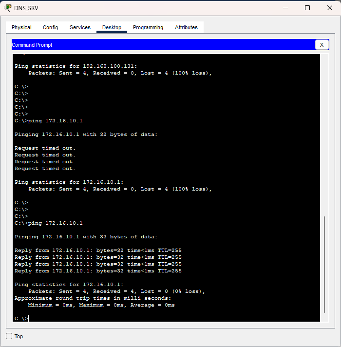

## Verification Evidence

### Inside-to-DMZ and outside traffic allowed

The inside client successfully reached the DMZ DHCP/DNS servers and the simulated external server.


### DMZ gateway reachable

The DMZ server successfully reached the ASA DMZ interface at `172.16.10.1`.



### DMZ-to-inside traffic denied

A DMZ server could not initiate ICMP traffic toward the trusted inside network.


### Outside-to-inside traffic denied

An outside host could not initiate traffic toward the trusted inside network.


Suggested evidence commands:

```cisco
show ip
show route
show ospf neighbor
show nat
show run | include access-list
show run | include access-group
show running-config
```
